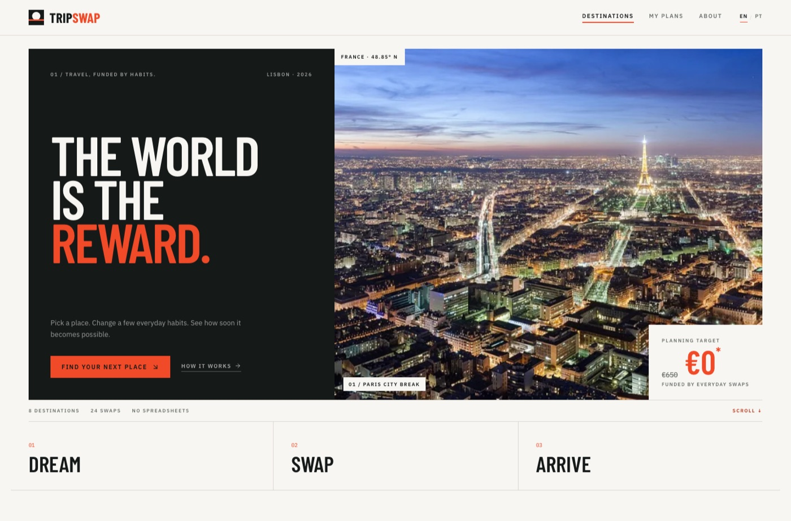
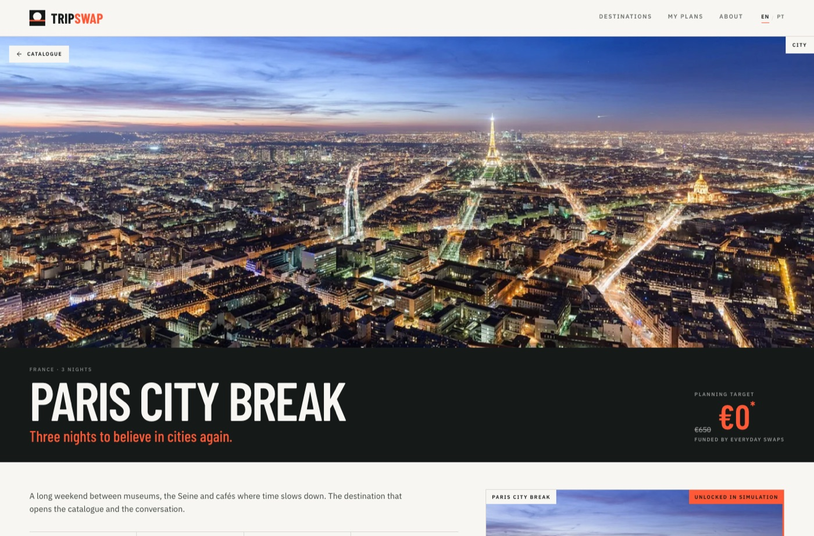
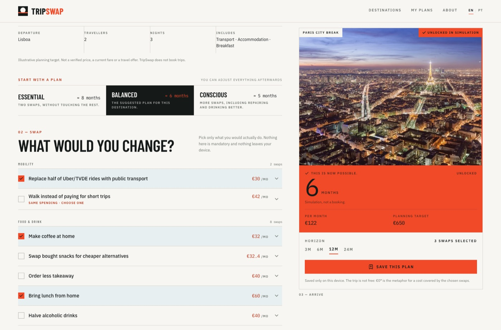
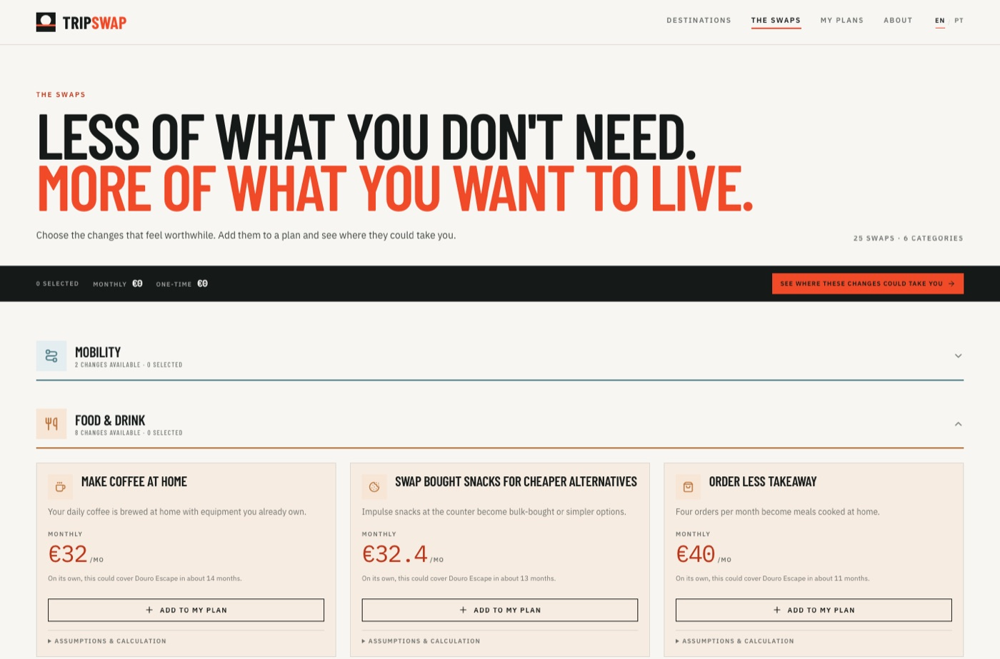
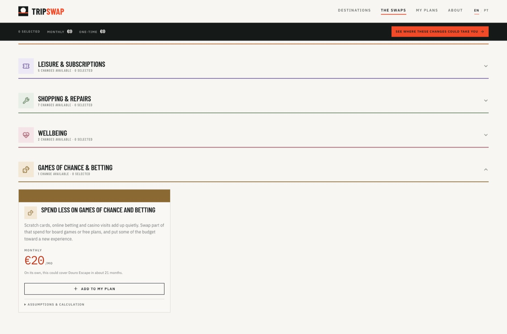
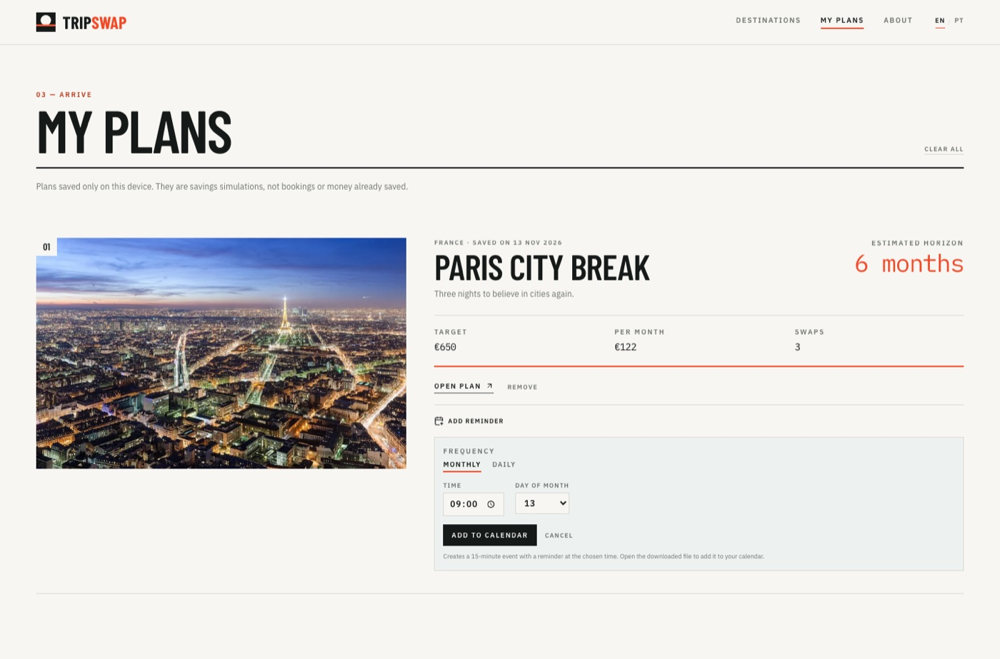

# TripSwap

[Português](README.pt.md) · **English**

**Small changes. Bigger journeys.**

[](https://github.com/blamelas/tripswap/actions/workflows/ci.yml)

TripSwap is a premium travel discovery experience that shows how small, realistic
changes in everyday habits could finance a meaningful trip. Users browse a curated
catalogue, choose swaps they would genuinely consider, and watch the projected savings
and funding horizon update instantly.

> The trip is not free. The **€0\*** is a metaphor for a cost covered by savings
> accumulated through the selected swaps. The real planning target is always visible.

| | |
|---|---|
| **Local demo** | `npm run dev` → http://localhost:5173 |
| **Live demo** | https://tripswap-home.vercel.app/ |
| **Repository** | https://github.com/blamelas/tripswap |
| **Defense script** | [`docs/DEFENSE.md`](docs/DEFENSE.md) (English) |
| **5-minute script** | [`docs/DEFENSE-5MIN.md`](docs/DEFENSE-5MIN.md) (pt-PT) |
| **10-minute deck script** | [`docs/DECK-SCRIPT.md`](docs/DECK-SCRIPT.md) (English) |
| **Slides** | [`docs/TripSwap-Defense.pptx`](docs/TripSwap-Defense.pptx) · [PDF](docs/TripSwap-Defense.pdf) |
| **Submission pack** | [`docs/SUBMISSION.md`](docs/SUBMISSION.md) |
| **Assumptions** | [`docs/ASSUMPTIONS.md`](docs/ASSUMPTIONS.md) (pt-PT) |
| **Status** | working MVP, 4 user stories, PT/EN toggle, fictional data, local persistence |



---

## The problem

People who want to travel already know where they want to go. What is missing is not
inspiration: it is a bridge between desire and money. Existing tools start with
budgets, bank statements and spreadsheets — and lose the person on the first screen.

TripSwap starts with desire. It shows the real planning cost, proposes small swaps and
answers a single question: **how long until this is within my reach?**

## Who it is for

A traveller in Lisbon, 25–40, who already has a destination in mind and wants a
concrete plan without handing financial data to yet another app. One person, one flow,
one primary screen.

## The 4 user stories

1. **Discover** destinations with transparent planning targets.
2. **Select** realistic changes without entering income, expenses or bank details.
3. **Understand** the potential savings and estimated horizon, with the maths visible.
4. **Save** goals and plans locally to come back later.

### Minimum moment of value

Under 60 seconds, no account: open **Paris City Break**, choose **Balanced**, and watch
**€122/month** become **6 months**. The card turns coral and the rail climbs the
photograph — the trip stops being an idea and becomes a dated plan.

## Features: MVP and backlog

| In the MVP | In the backlog |
|---|---|
| 8 destinations and 25 swaps | Accounts and sync |
| Deterministic engine with overlap groups | Live prices and flight APIs |
| Unlocks, deep links and local persistence | Booking and payments |
| PT/EN parity, `.ics` reminders, responsive UI | Maps, weather, e2e tests, observability |

The scope rule was always the same: without this, does the user still get the central
value — a cost and a horizon they can defend?

## What makes it different

- **The insight is the product.** The value is not the CRUD; it is the computed number
  and the horizon that moves as you choose.
- **Overlaps are explicit.** Two swaps that assume the same spending are never added
  together: they belong to the same group and only one can be active.
- **One-time savings are not monthly income.** Repairs and resales enter the projection
  once.
- **Full transparency.** Every result screen includes the calculation receipt and the
  €0\* note.
- **A signature interaction.** Choosing swaps makes the destination rise: a coral rail
  climbs the photograph, the image moves closer and the months counter animates.
- **Plans become routines.** Saved plans can create a daily or monthly calendar event
  with a reminder at a chosen time; the reminder preference stays on the device.
- **Bilingual by design.** English is the default and Portuguese is one click away.
  The toggle changes every string — including the 25 swaps and 8 destinations — while
  the numbers stay identical.
- **No health promises.** Benefits are qualitative tags.



---

## Design direction

**The world is the reward.** TripSwap is a travel magazine redesigned as a product:
full-bleed photography, condensed display type and one signal colour.

| Token | Value |
|---|---|
| Canvas | `#F7F6F2` |
| Ink | `#151A19` |
| Signal | `#F04A28` |
| Signal deep (small text) | `#B83417` |
| Pale blue | `#D8E8EE` |
| Display | Barlow Condensed |
| Interface | IBM Plex Sans |
| Numbers | IBM Plex Mono |

The €0* block always shows the illustrative budget crossed out, the €0* expression and
the "funded by everyday swaps" line. Every destination card turns the €0* into the
call to action, with "Unlock this experience" directly underneath. In the detail page,
the destination photograph is the progress surface: a rising tide and a coral edge rail
connect selected swaps, the monthly saving and the time to the target. When the plan
reaches the target, the reward card itself turns signal: the same photo, the same
height, a check and **“This is now possible.”** replace the neutral info block. Nothing
is added below; only the card transforms. On mobile the funding bar turns signal.

Habit rows keep only the activity name, the saving and the selected state; descriptions,
assumptions and benefits sit behind a chevron. Categories are chapter markers: a 44px
tinted icon, a 21px title, a live “N changes available · N selected” summary and a 2px
category-coloured rule. They collapse from the header and keep selections. Trip facts
are icon-led, and suggested plans live in a pale-blue band at the start of the swap
step, clearly separate from the trip data.



## Stack

| Area | Choice |
|---|---|
| Framework | React 19 + TypeScript (strict) |
| Build | Vite 8 |
| Styling | Tailwind CSS 3.4, Barlow Condensed / IBM Plex Sans / IBM Plex Mono |
| Router | React Router 7 |
| Icons | Lucide |
| Chart | Hand-rolled SVG, no chart library |
| Persistence | `localStorage` (`tripswap:unlocks:v1`) |
| Tests | Vitest — 42 tests |
| Environment | Multi-stage Docker + DevContainer |
| Deploy | Vercel (production, auto-deploy from `main`) |
| AI in development | DeepSeek (`deepseek-flash`) as the coding agent |

## Run it

Requirements: Node.js 20+ and npm.

```bash
npm ci && npm run dev
```

Open http://localhost:5173. Demo data is in the code: no setup, seed or API.

### With Docker

```bash
docker compose up
```

Open http://localhost:5173. Changes reload automatically.

### Quality

```bash
npm run lint        # oxlint
npm run typecheck   # tsc
npm test            # 42 tests (engine, data, assets, formatting, i18n, reminders)
npm run build       # production build
node scripts/assumptions.mjs > docs/ASSUMPTIONS.md   # regenerate assumptions
```

### Production and monitoring

- **Deploy:** Vercel builds `main` automatically; HTTPS is automatic.
- **Secrets:** there are no runtime secrets in the SPA; if any are added, they go in
  the Vercel dashboard, never in the repo. `.env.local` is ignored.
- **Logs:** build and runtime logs in the Vercel dashboard.
- **Uptime:** a free UptimeRobot HTTP monitor on the public URL, alerting by email
  after 5 minutes down.
- **Dependencies:** `npm audit` before each release.

## How the calculation works

- **Recurring:** `(original cost − alternative) × monthly frequency`
- **One-time:** `original cost − alternative`, once
- **Projection:** `monthly savings × months + one-time savings`
- **Horizon:** the first whole month at which the projection reaches the target

The engine lives in [`src/lib/calc.ts`](src/lib/calc.ts) and is the single source of
truth. A test asserts that each of the 25 swaps keeps its documented value. The engine
also removes overlaps defensively, even if it receives an unsanitised list (old deep
link or edited `localStorage`).

### The swaps catalogue

A dedicated `/swaps` page presents all 25 changes across six categories, independent of
any destination. It uses the same habit data, calculator and overlap rules as the
destination flow. **Games of chance & betting** uses a fixed, conservative estimate — €40 current,
€20 reduced, €20/month — with no user inputs and no invented average. Selected swaps are stored locally and carried into any destination
plan through the destination links and the global selection.

Each activity has a distinct icon and a **soft category-colour tint** behind the card.
Photography remains destination-led; the tint makes the grid pop without photo strips.
Selecting a swap shows a standard monochrome check in the card. Categories start
collapsed; opening one closes the others, keeping the catalogue short.





### Plan reminders

A saved plan can create a daily or monthly calendar event with a reminder at a chosen
time. The downloadable `.ics` contains a 15-minute event and a `VALARM`; the preference
(frequency, time, day) stays in the browser. There are no push notifications and no
server.



## Structure

```text
src/
  data/      destinations, swaps, assumptions
  lib/       engine, conflicts, formatting, presets, storage
  i18n/      typed PT/EN dictionaries, content and locale context
  components/
  views/     Discover, Destination detail, Swaps, Unlocks, About
tests/       engine, data, assets, formatting
docs/        MVP, assumptions, decisions, iterations, testing, defense
```

## Explicit limitations

- **Illustrative** planning targets (Lisbon, 2 travellers, stated scope). They are not
  verified prices, current fares or offers.
- No booking, payments, user accounts or sync.
- No live pricing, maps, weather or external APIs.
- Browser-only persistence; clearing site data removes saved plans.
- The horizon is an arithmetic projection, not a savings guarantee.
- Local photography with licences listed in [`docs/CREDITS.md`](docs/CREDITS.md).

## Documentation

- [`docs/MVP.md`](docs/MVP.md) — scope, user stories, acceptance criteria
- [`docs/ASSUMPTIONS.md`](docs/ASSUMPTIONS.md) — every assumption, generated from code
- [`docs/DECISIONS.md`](docs/DECISIONS.md) — decisions and trade-offs
- [`docs/ITERATIONS.md`](docs/ITERATIONS.md) — build cycles
- [`docs/TESTING.md`](docs/TESTING.md) — automated tests and manual checklist
- [`docs/PROMPTS.md`](docs/PROMPTS.md) — real prompts and one real AI failure
- [`docs/DEFENSE.md`](docs/DEFENSE.md) — English demo runbook and full defence script
- [`docs/DEFENSE-5MIN.md`](docs/DEFENSE-5MIN.md) — guião de 5 minutos (limite do Módulo 07)
- [`docs/DECK-SCRIPT.md`](docs/DECK-SCRIPT.md) — English 10-minute slide script
- [`docs/QA.md`](docs/QA.md) — English rehearsal flashcards (26 questions)
- [`docs/VIDEO.md`](docs/VIDEO.md) — English 3-minute backup video script
- [`docs/SUBMISSION.md`](docs/SUBMISSION.md) — English course requirement → evidence map
- [`docs/TripSwap-Defense.pptx`](docs/TripSwap-Defense.pptx) — 10-slide English deck · [`PDF`](docs/TripSwap-Defense.pdf)
- [`CLAUDE.md`](CLAUDE.md) — agent context and rules

The interface is fully bilingual (PT-PT / EN) with a persistent toggle. Documentation
is available in Portuguese ([README.pt.md](README.pt.md)) and English (this file).

## How AI helped

AI was used as a coding agent inside the repository: scaffold, data, engine,
components, tests and documentation. It was **not** used for runtime arithmetic, price
generation or health claims. The process is recorded in
[`docs/ITERATIONS.md`](docs/ITERATIONS.md) and [`docs/PROMPTS.md`](docs/PROMPTS.md),
including a real failure caught by a test.

### What went well

- The calculation contract was specified before the UI: inputs, outputs, `null` above
  240 months. The agent could then be tested instead of trusted.
- One story per cycle kept each diff small and the review honest.
- The agent wrote the overlap groups and the defensive dedupe in the engine, which
  made old deep links safe.

### What was hard

- The first `calculatePlan` added every swap, even two in the same `exclusiveGroup`.
  The UI replaced correctly, but the engine accepted an unsanitised list. A test the
  agent wrote caught it: two snack swaps produced two lines instead of one. I fixed
  the engine, not the test.
- Keeping PT/EN in true parity — every string, every swap, every number identical —
  needed a dedicated test rather than trust.
- The visual direction was rewritten once: the first version was competent but
  generic; desire had to be the interface, not a decoration.

### A real prompt

> “Cria `src/lib/calc.ts` com: `monthlySaving`, `oneTimeSaving`, `projectedSavings`,
> `monthsToTarget` e `calculatePlan`. Regras: recorrente = `(original − alternativa) ×
> frequência`; pontual = diferença, contada uma vez; prazo = primeiro mês inteiro;
> devolve `null` acima de 240 meses. Não formata nada; não toca em componentes. Depois
> cria `tests/calc.test.ts` com os valores documentados e os casos-limite. Corre os
> testes.”

This is cycle 1 in [`docs/PROMPTS.md`](docs/PROMPTS.md). It produced the engine and 21
tests — and the failure above.

## Status and next steps

The MVP is live and complete against the four stories. Next: a pre-rendered catalogue,
accounts and sync, custom swaps, savings tracking, and end-to-end tests. The explicit
non-goals remain auth, booking, live prices and a backend.

## Credits

Photography: Wikimedia Commons / Unsplash, with authors and licences in
[`docs/CREDITS.md`](docs/CREDITS.md). Type: Barlow Condensed, IBM Plex Sans and IBM
Plex Mono (SIL Open Font License), self-hosted via Fontsource.

Final project for **Building Digital Products with Generative AI** — EUNICE Network,
2026.
