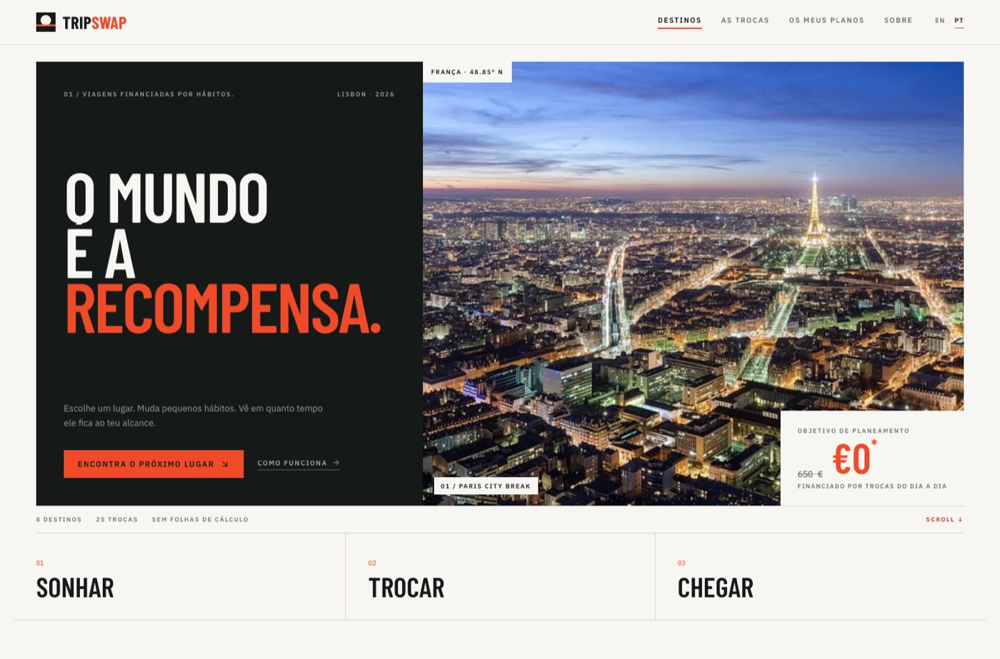
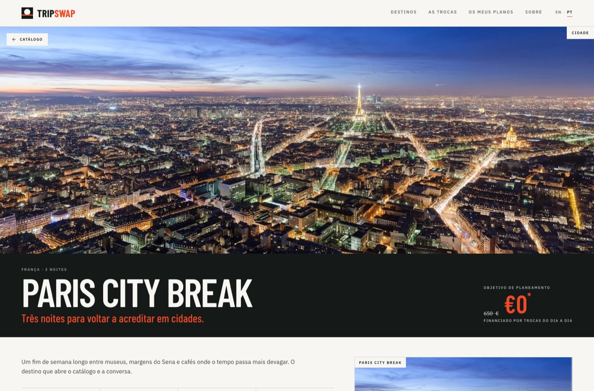
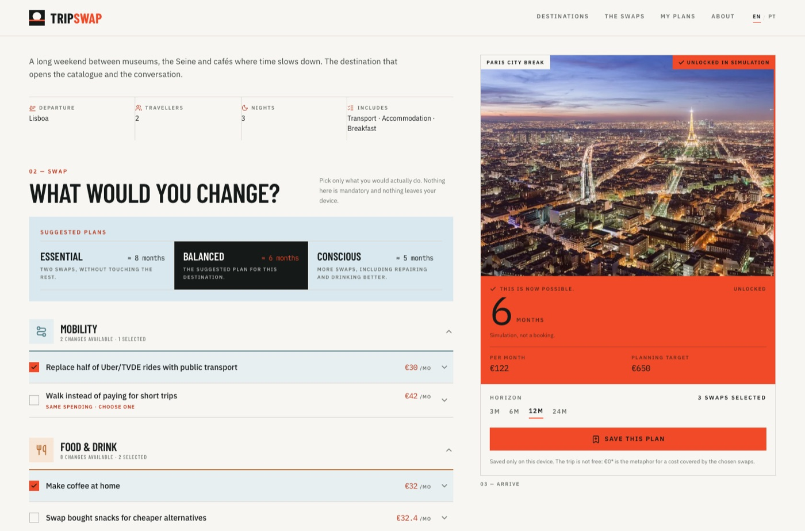
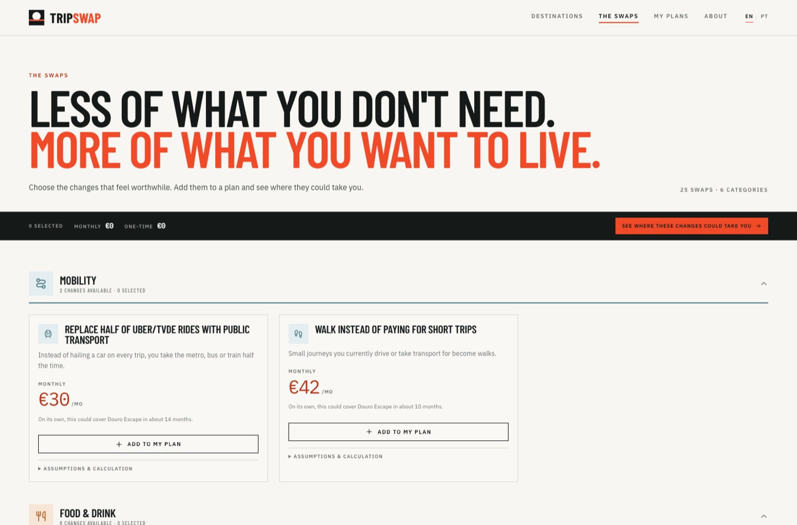
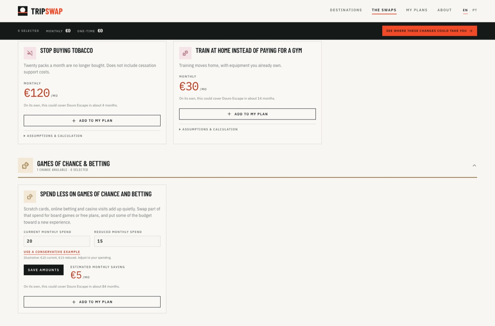
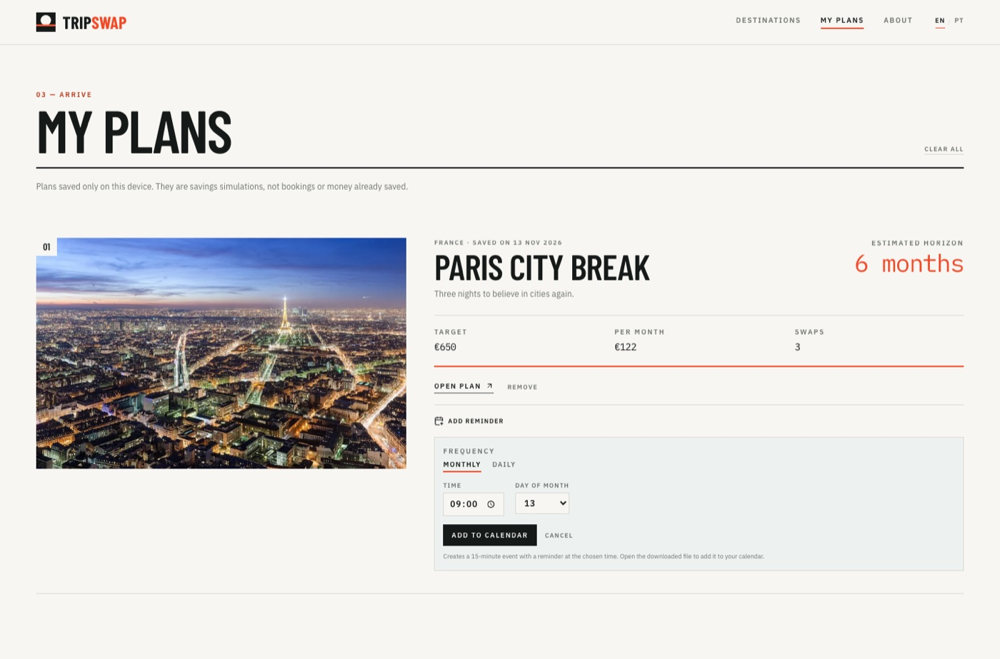

# TripSwap

**Português** · [English](README.md)

**Small changes. Bigger journeys.**

[](https://github.com/blamelas/tripswap/actions/workflows/ci.yml)

O TripSwap é uma experiência de descoberta de viagens que mostra como pequenas
mudanças realistas nos hábitos do dia a dia podem financiar uma viagem com significado.
O utilizador explora um catálogo curado, escolhe trocas que faria mesmo e vê a poupança
projetada e o prazo de financiamento a atualizar-se de imediato.

> A viagem não é gratuita. O **€0\*** é uma metáfora para um custo coberto pela
> poupança acumulada nas trocas escolhidas. O objetivo real de planeamento está sempre
> visível.

| | |
|---|---|
| **Demo local** | `npm run dev` → http://localhost:5173 |
| **Demo pública (Vercel)** | https://tripswap-home.vercel.app/ |
| **Repositório** | https://github.com/blamelas/tripswap |
| **Guião de defesa** | [`docs/DEFENSE.md`](docs/DEFENSE.md) |
| **Slides** | [`docs/TripSwap-Defense.pptx`](docs/TripSwap-Defense.pptx) |
| **Pacote de submissão** | [`docs/SUBMISSION.md`](docs/SUBMISSION.md) |
| **Pressupostos** | [`docs/ASSUMPTIONS.md`](docs/ASSUMPTIONS.md) |
| **Estado** | MVP funcional, 4 user stories, toggle PT/EN, dados fictícios, persistência local |



---

## O problema

Quem quer viajar já sabe para onde quer ir. O que falta não é inspiração: é uma ponte
entre o desejo e o dinheiro. As ferramentas existentes começam em orçamentos, extratos
e folhas de cálculo — e perdem a pessoa no primeiro ecrã.

O TripSwap começa no desejo. Mostra o custo real de planeamento, propõe trocas pequenas
e responde a uma única pergunta: **em quanto tempo isto fica ao meu alcance?**

## Para quem

Um viajante em Lisboa, entre os 25 e os 40 anos, que já tem um destino em mente e quer
um plano concreto sem entregar dados financeiros a mais uma aplicação. Uma pessoa, um
fluxo, um ecrã principal.

## As 4 user stories

1. **Descobrir** destinos com orçamentos de planeamento transparentes.
2. **Selecionar** mudanças realistas sem introduzir rendimentos, despesas ou dados bancários.
3. **Entender** a poupança potencial e o prazo estimado, com o cálculo visível.
4. **Guardar** objetivos e planos localmente para voltar mais tarde.

## O que distingue o produto

- **O insight é o produto.** O valor não está no CRUD; está no número calculado e no
  prazo que muda enquanto escolhes.
- **Sobreposições são explícitas.** Duas trocas que assumem a mesma despesa nunca são
  somadas: pertencem ao mesmo grupo e só uma pode estar ativa.
- **Poupanças pontuais não são rendimento mensal.** Reparações e vendas entram uma vez.
- **Transparência total.** Cada ecrã de resultado inclui o recibo do cálculo e a nota
  sobre o €0\*.
- **Uma interação-assinatura.** Escolher trocas faz o destino subir: uma linha coral
  sobe pela fotografia, a imagem aproxima-se e o contador de meses anima.
- **Planos tornam-se rotinas.** Um plano guardado pode criar um evento diário ou mensal
  no calendário, com lembrete a uma hora escolhida; a preferência fica no dispositivo.
- **Bilingue por desenho.** O inglês é o idioma por omissão e o português está a um
  clique. O toggle muda toda a copy — incluindo as 25 trocas e os 8 destinos — e os
  números mantêm-se iguais.
- **Nenhuma promessa de saúde.** As vantagens são etiquetas qualitativas.



---

## Direção de arte

**The world is the reward.** O TripSwap é uma revista de viagens redesenhada como
produto: fotografia full-bleed, tipografia condensada e uma única cor-sinal.

| Token | Valor |
|---|---|
| Canvas | `#F7F6F2` |
| Ink | `#151A19` |
| Signal | `#F04A28` |
| Signal deep (small text) | `#B83417` |
| Azul pálido | `#D8E8EE` |
| Display | Barlow Condensed |
| Interface | IBM Plex Sans |
| Números | IBM Plex Mono |

O bloco €0* mostra sempre o orçamento ilustrativo riscado, a expressão €0* e a linha
"financiado por trocas". Em cada cartão de destino, o €0* é o call to action, com
"Desbloquear esta experiência" logo abaixo. No detalhe, a fotografia do destino é a
superfície de progresso: uma maré crescente e uma linha coral ligam as trocas
escolhidas, a poupança mensal e o tempo até ao objetivo. Quando o plano atinge o
alvo, é o próprio cartão de recompensa que fica signal: a mesma fotografia, a mesma
altura, um check e **“Isto agora é possível.”** substituem o bloco neutro. Nada é
acrescentado abaixo; só o cartão se transforma. No telemóvel, a barra de funding fica
signal.

As linhas de hábitos mostram apenas o nome, a poupança e o estado selecionado;
descrições, premissas e benefícios ficam atrás de um chevron. As categorias são
marcadores de capítulo: ícone de 44px em fundo tingido, título de 21px, resumo ao vivo
“N trocas disponíveis · N selecionadas” e uma regra de 2px na cor da categoria. Podem
colapsar a partir do cabeçalho e mantêm as seleções. Os dados da viagem têm ícones, e
os planos sugeridos vivem numa faixa azul-pálida no início do passo de troca.



## Stack

| Área | Escolha |
|---|---|
| Framework | React 19 + TypeScript (strict) |
| Build | Vite 8 |
| Estilo | Tailwind CSS 3.4, Barlow Condensed / IBM Plex Sans / IBM Plex Mono |
| Router | React Router 7 |
| Ícones | Lucide |
| Gráfico | SVG próprio, sem biblioteca de charts |
| Persistência | `localStorage` (`tripswap:unlocks:v1`) |
| Testes | Vitest — 45 testes |
| Ambiente | Docker multi-stage + DevContainer |
| Deploy | Vercel (estático) |
| AI no desenvolvimento | DeepSeek (`deepseek-flash`) como agente de código |

## Correr localmente

Requisitos: Node.js 20+ e npm.

```bash
npm ci && npm run dev
```

Abre http://localhost:5173. Os dados de demonstração estão no código: não há setup,
seed nem API.

### Com Docker

```bash
docker compose up
```

Abre http://localhost:5173. As alterações recarregam automaticamente.

### Qualidade

```bash
npm run lint        # oxlint
npm run typecheck   # tsc
npm test            # 45 testes (motor, dados, assets, formatação, i18n, lembretes)
npm run build       # build de produção
node scripts/assumptions.mjs > docs/ASSUMPTIONS.md   # regenera os pressupostos
```

## Como o cálculo funciona

- **Recorrente:** `(custo original − alternativa) × frequência mensal`
- **Pontual:** `custo original − alternativa`, uma única vez
- **Projeção:** `poupança mensal × meses + poupanças pontuais`
- **Prazo:** o primeiro mês inteiro em que a projeção atinge o objetivo

O motor vive em [`src/lib/calc.ts`](src/lib/calc.ts) e é a única fonte de verdade. Um
teste garante que cada uma das 25 trocas mantém o valor documentado. O motor também
elimina sobreposições de forma defensiva, mesmo que receba uma lista não sanitizada
(link direto antigo ou `localStorage` editado).

### O catálogo de trocas

A página `/swaps` apresenta as 25 mudanças em seis categorias, independentemente de
qualquer destino. Usa os mesmos dados, motor e regras de sobreposição do fluxo de
destino. **Jogos de azar e apostas** usa o gasto mensal atual e o valor reduzido
introduzidos pelo utilizador — sem médias inventadas — e não mostra poupança numérica
enquanto os dois valores não existirem. As trocas escolhidas ficam guardadas localmente
e seguem para qualquer plano através dos links de destino e da seleção global.

Cada atividade tem um ícone próprio na cor da categoria; a fotografia continua
reservada aos destinos, para que os cartões não se tornem tiles repetidos de stock.
Dois cartões tracejados mostram o roadmap de “Criar a minha troca” e “Adicionar a minha
viagem de sonho”.





### Lembretes de plano

Um plano guardado pode criar um evento diário ou mensal no calendário, com lembrete a
uma hora escolhida. O `.ics` transferido contém um evento de 15 minutos e um `VALARM`;
a preferência (frequência, hora, dia) fica no browser. Não há push notifications nem
servidor.



## Estrutura

```text
src/
  data/      destinos, trocas, pressupostos
  lib/       motor, conflitos, formatação, presets, storage
  i18n/      dicionários PT/EN tipados, conteúdo e contexto de idioma
  components/
  views/     Descobrir, Detalhe, Swaps, Unlocks, Sobre
tests/       motor, dados, formatação
docs/        MVP, pressupostos, decisões, iterações, testes, defesa
```

## Limitações explícitas

- Orçamentos **ilustrativos** de planeamento (Lisboa, 2 viajantes, âmbito indicado).
  Não são preços verificados, tarifas atuais nem ofertas.
- Sem reservas, pagamentos, contas de utilizador ou sincronização.
- Sem preços em tempo real, mapas, clima ou APIs externas.
- Persistência apenas no navegador; limpar os dados do site remove os planos.
- O prazo é uma projeção aritmética, não uma garantia de poupança.
- Fotografias locais com licenças indicadas em [`docs/CREDITS.md`](docs/CREDITS.md).

## Documentação

- [`docs/MVP.md`](docs/MVP.md) — scope, user stories e critérios de aceitação
- [`docs/ASSUMPTIONS.md`](docs/ASSUMPTIONS.md) — todas as premissas, geradas do código
- [`docs/DECISIONS.md`](docs/DECISIONS.md) — decisões e trade-offs
- [`docs/ITERATIONS.md`](docs/ITERATIONS.md) — ciclos de construção
- [`docs/TESTING.md`](docs/TESTING.md) — testes automáticos e checklist manual
- [`docs/PROMPTS.md`](docs/PROMPTS.md) — prompts reais e uma falha do AI
- [`docs/DEFENSE.md`](docs/DEFENSE.md) — slides, demo e Q&A
- [`docs/QA.md`](docs/QA.md) — cartões de treino
- [`docs/VIDEO.md`](docs/VIDEO.md) — guião do vídeo de backup
- [`docs/SUBMISSION.md`](docs/SUBMISSION.md) — requisito do curso → evidência
- [`docs/TripSwap-Defense.pptx`](docs/TripSwap-Defense.pptx) — deck de 10 slides
- [`CLAUDE.md`](CLAUDE.md) — contexto e regras para o agente

## Como a IA ajudou

A IA foi usada como agente de código dentro do repositório: scaffold, dados, motor,
componentes, testes e documentação. **Não** foi usada para aritmética em runtime, nem
para gerar preços, nem para validar afirmações de saúde. O processo está em
[`docs/ITERATIONS.md`](docs/ITERATIONS.md) e [`docs/PROMPTS.md`](docs/PROMPTS.md),
incluindo uma falha real detetada por um teste.

## Créditos

Fotografia: Wikimedia Commons / Unsplash, com autores e licenças em
[`docs/CREDITS.md`](docs/CREDITS.md). Tipografia: Barlow Condensed, IBM Plex Sans e IBM
Plex Mono (SIL Open Font License), servidas localmente via Fontsource.

Projeto final do curso **Building Digital Products with Generative AI** — EUNICE
Network, 2026.
